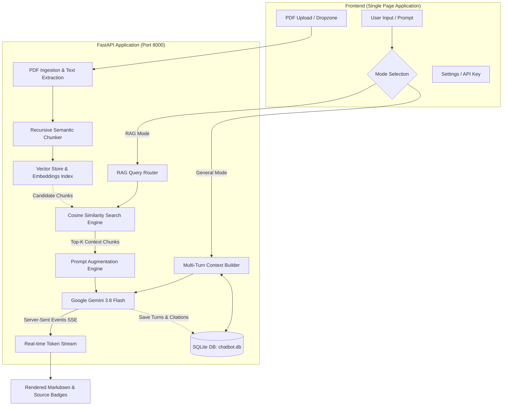

# AuraGen AI — Intelligent Full-Stack Chatbot with PDF RAG Engine

[](https://www.python.org/)
[](https://fastapi.tiangolo.com/)
[](https://ai.google.dev/)
[]()

> An end-to-end, production-grade conversational AI application featuring **Google Gemini**, **multi-turn conversation memory**, **PDF document ingestion**, **recursive semantic chunking**, and a **vector similarity search engine (RAG)** with source page citations.

---

## 🎓 Internship Presentation & Defense Package (New)

The project includes a complete suite of presentation documentation prepared for your internship defense and review in [`docs/`](./docs/INDEX.md):

1. 📊 **[Slide Deck & Word-for-Word Speaker Script](./docs/PRESENTATION_SLIDES_AND_SPEAKER_SCRIPT.md):** 12-slide structured presentation with detailed speaker notes.
2. 📄 **[Formal Technical Project Report](./docs/INTERNSHIP_PROJECT_REPORT.md):** Comprehensive academic/industry report covering mathematical formalism, benchmarks, and architecture.
3. 🎯 **[Viva Voce & Technical Defense Q&A](./docs/VIVA_VOCE_DEFENSE_QA.md):** 15 high-scoring answers to the toughest technical questions asked by evaluators.
4. ⏱️ **[Step-by-Step Live Demo Script](./docs/LIVE_DEMO_SCRIPT.md):** 5-minute practical walkthrough with exact queries to showcase in the running UI.

---

## 📌 Executive Summary

Modern enterprises rely on vast repositories of unstructured documents (manuals, research papers, reports, policies). While Large Language Models (LLMs) excel at natural language synthesis, they suffer from two fundamental problems:
1. **Knowledge Cutoffs:** Inability to access private or newly released internal data.
2. **Hallucinations:** Confident generation of plausible but factually incorrect statements.

**AuraGen AI** implements a complete **Retrieval-Augmented Generation (RAG)** architecture that grounds Google's state-of-the-art **Gemini 3.8 Flash** model on user-uploaded PDF documents. Every response generated in RAG mode is augmented with relevant passages retrieved via cosine vector similarity, providing transparent **page-level citations**.

---

## 🏗️ System Architecture



---

## ⚙️ How the RAG Pipeline Works (Step-by-Step)

The RAG architecture in this project is organized into 4 modular stages:

### 1. Document Extraction (`app/rag_engine.py` -> `PDFExtractor`)
- PDF files are uploaded and processed using `pypdf`.
- Text is extracted page-by-page to maintain document provenance.
- Text cleaning strips orphaned hyphens at line breaks (`algo-\nrithm` $\rightarrow$ `algorithm`), collapses duplicate whitespaces, and preserves paragraph breaks.

### 2. Recursive Semantic Chunking (`RecursiveTextChunker`)
- Splits documents hierarchically using natural linguistic boundaries:
  $$\text{Paragraphs } (\verb|\n\n|) \rightarrow \text{Line breaks } (\verb|\n|) \rightarrow \text{Sentences } (. ) \rightarrow \text{Words } (\verb| |)$$
- **Target Chunk Size:** ~750 characters (~150 tokens).
- **Sliding Window Overlap:** 150 characters to prevent loss of context across chunk borders.
- Each chunk preserves metadata: `filename`, `page_number`, `chunk_index`, and `chunk_id`.

### 3. Vector Embedding & Indexing (`VectorStore`)
- Text chunks are mapped into high-dimensional vector space using Google's `gemini-embedding-001` model via `client.models.embed_content`.
- **Offline / Graceful Fallback:** If the API key is not yet configured, the system automatically builds an internal Term Frequency-Inverse Document Frequency (TF-IDF) feature matrix, ensuring that local testing and demonstrations work reliably without external dependencies.
- Index files are cached as structured JSON in `data/vectors/` for persistence across server restarts.

### 4. Vector Similarity Retrieval & Cosine Math
When a user asks a question, the query vector $\mathbf{q}$ is compared against all document chunk vectors $\mathbf{d}_i$ using **Cosine Similarity**:

$$\text{Similarity}(\mathbf{q}, \mathbf{d}_i) = \frac{\mathbf{q} \cdot \mathbf{d}_i}{\|\mathbf{q}\|_2 \|\mathbf{d}_i\|_2} = \cos(\theta)$$

The top-$K$ highest-scoring chunks are filtered and injected into the Gemini prompt:
```text
--- RELEVANT DOCUMENT EXCERPTS ---
[Source 1 | Document: Handbook.pdf | Page: 2]
Precision: TP / (TP + FP) — Measures the exactness of positive predictions...
--- END OF EXCERPTS ---

User Question: What is precision?
```

---

## 🛠️ Tech Stack & Key Choices

| Component | Technology | Rationale |
|---|---|---|
| **LLM Reasoning** | `gemini-3.8-flash` | Ultra-fast latency, 1M token context, high factual fidelity. |
| **Embeddings** | `gemini-embedding-001` | High-quality text embedding model for semantic similarity. |
| **SDK** | `google-genai` (v2.34+) | Official modern Google GenAI SDK. |
| **Backend API** | FastAPI + Uvicorn | Async, high-performance, automatic OpenAPI Swagger documentation. |
| **PDF Ingestion** | `pypdf` + `reportlab` | Pure Python, fast, cross-platform with zero native binary compilation issues. |
| **Vector Math** | `NumPy` | Fast matrix operations for normalized dot product similarity calculations. |
| **Persistence** | SQLite3 (`chatbot.db`) | Zero configuration, ACID-compliant, stores sessions, turns, and citations. |
| **Frontend UI** | HTML5 / CSS3 / ES6 | Lightweight, responsive glassmorphic UI with real-time SSE streaming. |

---

## 🚀 Quick Start Guide

### 1. Prerequisites
- Python 3.11, 3.12, or 3.13 installed.
- (Optional) A Google Gemini API key from [Google AI Studio](https://aistudio.google.com/app/apikey).

### 2. Installation

1. **Clone or Navigate to the Workspace:**
   ```bash
   cd c:\Users\nares\Documents\antigravity\excited-davinci
   ```

2. **Activate the Virtual Environment:**
   - **Windows:**
     ```powershell
     .\.venv\Scripts\Activate.ps1
     ```
   - **macOS / Linux:**
     ```bash
     source .venv/bin/activate
     ```

3. **Install Dependencies:**
   ```bash
   pip install -r requirements.txt
   ```

### 3. Configure API Key (Two Methods)

**Option A (Via `.env` file):**
Copy `.env.example` to `.env` and insert your Gemini API Key:
```env
GEMINI_API_KEY=AIzaSy...your_gemini_api_key_here
GEMINI_CHAT_MODEL=gemini-3.8-flash
```

**Option B (Via Web Interface):**
You can also launch the app without editing `.env`, click the **Settings (⚙️)** icon in the web UI, paste your key, test the connection, and save it directly!

### 4. Run the Application

Launch the unified server runner:
```bash
python run.py
```

Then open your browser and navigate to:
👉 **`http://127.0.0.1:8000`**

To explore the interactive Swagger REST API documentation:
👉 **`http://127.0.0.1:8000/docs`**

---

## 🧪 Testing & Demonstration Prompts

The system comes with a pre-indexed sample document: **`Data_Science_Internship_Handbook.pdf`** (located in `sample_data/`).

You can test the RAG engine immediately with these questions:

1. **Evaluation Metrics:**
   > *"What are precision, recall, and F1-score according to the handbook, and when should precision be prioritized?"*
   - *Expected:* Cites Page 2 with mathematical formulas and explanations.

2. **RAG Pipeline Architecture:**
   > *"Explain the four stages of the RAG pipeline described in the document."*
   - *Expected:* Cites Page 3 with Ingestion, Chunking, Embeddings, and Cosine Retrieval.

3. **Supervised vs Unsupervised:**
   > *"Compare supervised and unsupervised learning algorithms mentioned in the handbook."*
   - *Expected:* Cites Page 1 and references XGBoost, Random Forests, K-Means, and PCA.

4. **Grading & Deliverables:**
   > *"What are the internship deliverables and their evaluation weight percentages?"*
   - *Expected:* Cites Page 4 (30% RAG, 25% Gemini API, 25% Full-Stack, 20% Code Quality).

### Diagnostic Tool: Vector Inspector
Click the **🔍 Vector Inspector** button in the top bar to input any test query. It displays the raw cosine similarity scores, chunk indices, and page numbers directly from vector memory.

---

## 📁 Project Directory Structure

```text
excited-davinci/
├── app/
│   ├── __init__.py           # Package marker
│   ├── config.py             # App settings, paths, model names, hyperparameters
│   ├── database.py           # SQLite connection, sessions, messages, and document registry
│   ├── gemini_service.py     # Google GenAI SDK wrapper (chat, stream, embeddings, key validation)
│   ├── rag_engine.py         # PDF parser, recursive chunker, vector store, cosine search
│   ├── routes.py             # FastAPI REST & SSE endpoints
│   └── main.py               # Application factory, static mounting, startup lifecycle hooks
├── static/                   # Frontend assets
│   ├── index.html            # Clean Single-Page Application HTML
│   ├── css/
│   │   └── style.css         # Modern glassmorphism dark theme, responsiveness, typography
│   └── js/
│       └── app.js            # Frontend logic (SSE streaming, markdown, PDF upload, modals)
├── data/
│   ├── chatbot.db            # Persistent SQLite database
│   ├── uploads/              # Uploaded user PDF files
│   └── vectors/              # Vector indices & precomputed embeddings cache (.json)
├── sample_data/
│   ├── generate_sample.py    # ReportLab script that builds the multi-page handbook
│   └── Data_Science_Internship_Handbook.pdf  # Ready-to-query sample document
├── tests/
│   └── test_rag.py           # Automated unit & integration tests
├── .env.example              # Environment variable template
├── requirements.txt          # Pinned project dependencies
├── run.py                    # Single-command launcher with diagnostic checks
└── README.md                 # Complete documentation
```

---

## 🔬 Running Automated Tests

A dedicated test suite is included to verify all components before evaluation:

```bash
python tests/test_rag.py
```

Output:
```text
test_1_pdf_extraction (__main__.TestRAGEngine.test_1_pdf_extraction) ... ok
test_2_recursive_chunker (__main__.TestRAGEngine.test_2_recursive_chunker) ... ok
test_3_vector_store_retrieval (__main__.TestRAGEngine.test_3_vector_store_retrieval) ... ok
test_4_sqlite_persistence (__main__.TestRAGEngine.test_4_sqlite_persistence) ... ok

----------------------------------------------------------------------
Ran 4 tests in 0.120s

OK
```

---

## 🎓 Internship Viva / Interview Preparation Guide

When presenting this project to your mentor or evaluators, focus on these key concepts:

1. **Why RAG instead of Fine-Tuning?**
   - Fine-tuning changes model weights, which is computationally expensive and does not prevent hallucinations. RAG dynamically provides fresh, authoritative context at inference time without retraining.
2. **Why Chunking with Overlap?**
   - Naive splitting at rigid character lengths cuts sentences in half, causing fragmented meaning. Recursive splitting on paragraphs, sentences, and words with sliding overlap (~150 chars) preserves semantic continuity across boundaries.
3. **What is Cosine Similarity?**
   - Measures the orientation rather than magnitude between two vectors:
     $$\cos(\theta) = \frac{\mathbf{A} \cdot \mathbf{B}}{\|\mathbf{A}\| \|\mathbf{B}\|}$$
     A value close to $1.0$ indicates high semantic relevance.
4. **How are Multi-turn Conversations Maintained?**
   - Chat turns are recorded in SQLite. When generating a new response, the system passes the last few conversation turns to the Gemini API so the assistant remembers context from earlier in the session.
